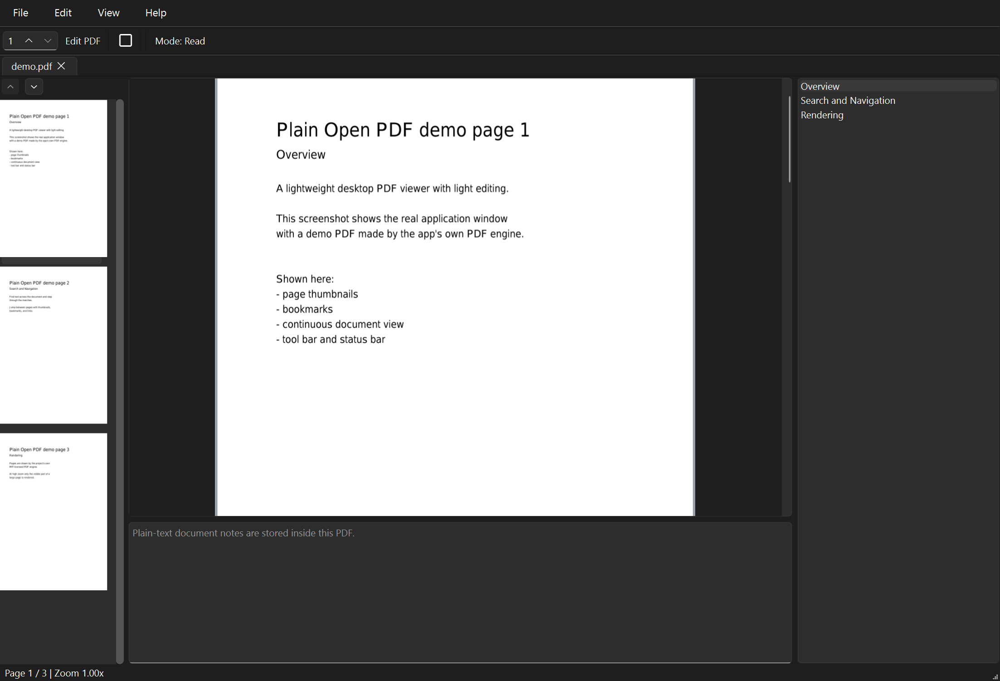

<!-- last_updated: 2026-11-17 -->
<!-- Authoring guidance: dev-docs/specs/README_SPEC.instructions.md -->
<!-- rumdl-disable MD033 MD041 -->

  

<h1 align="center">Plain Open PDF</h1>

  A lightweight desktop PDF viewer with light editing, for people who want to
  read, search, and touch up PDFs without a heavyweight suite.

  
  
  

  <a href="#download">Download</a> ·
  <a href="docs/USER_MANUAL.md">User manual</a> ·
  <a href="https://plaintxtoffice.com/apps/">Website</a>

<!-- rumdl-enable MD033 MD041 -->

---

## About

Plain Open PDF is a no-frills desktop reader for PDF files on Windows and Linux.
Open a document from your file manager or the command line and start reading
right away: pages render as you reach them instead of waiting for the whole
file. Light editing is there when you need it, such as redacting a region,
replacing a line of text, reordering pages, and saving the result back over the
original. The Windows portable build runs from a USB stick and keeps its
settings beside itself.

The [Linux implementation](platform/linux/README.md) uses Qt desktop controls,
XDG storage, and the desktop keyring. Its GitHub Actions build targets Ubuntu
24.04 x86-64; the first hosted build and Linux runtime verification are pending.

The initial [macOS implementation](platform/mac_os/README.md) adds Finder file
opening, native menus, Keychain storage, and app-bundle tooling. Its Python
tests pass on Windows; the first native Mac build and runtime checks are
pending.

## Features

- Open several PDFs at once in tabs you can drag to reorder; launching again
  forwards the file to the running window
- Read in continuous scrolling or single-page view, and navigate with page
  jumps, thumbnails, bookmarks, and links inside the PDF
- Zoom to actual size, fit width, fit page, or with `Ctrl` + mouse wheel
- Search the whole document as you type and copy selectable text
- Redact a page region or replace the text it covers
- Insert blank pages, reorder, rotate, or delete pages, and edit bookmarks
- Edit document metadata and keep plain-text notes stored inside the PDF
- Run optional Tesseract OCR on one page or the whole document
- Save in place, save a copy, rename the file, or print all or part of it
- Remember passwords for encrypted PDFs using Windows protection or Linux's
  Secret Service desktop keyring

## App Screenshot

## Download

| Platform | Download | Notes |
| --- | --- | --- |
| Windows (portable) | [plain-open-pdf.exe](https://github.com/PlainTxtOffice/plain-open-pdf/releases/latest/download/open-pdf.exe) | Runs without installation. |
| Windows (installer) | [plain-open-pdf-setup.exe](https://github.com/PlainTxtOffice/plain-open-pdf/releases/latest/download/open-pdf-setup.exe) | |

The Windows builds are for x64 (64-bit). Checksums and release notes are on the
[latest release](https://github.com/PlainTxtOffice/plain-open-pdf/releases/latest).

The executables are unsigned. To check a download, compare the output of
`Get-FileHash -Algorithm SHA256 PATH_TO_DOWNLOAD` with
[SHA256SUMS.txt](https://github.com/PlainTxtOffice/plain-open-pdf/releases/latest/download/SHA256SUMS.txt).
No Linux or macOS download has been released.

## User Manual

See the [User Manual](docs/USER_MANUAL.md) for installation, setup, usage, and
troubleshooting.

## Feedback

Bug reports and feature requests are welcome. Use the
[contact form](https://plaintxtoffice.com/contact/) on plaintxtoffice.com, or
open an issue on
[GitHub Issues](https://github.com/PlainTxtOffice/plain-open-pdf/issues). If Plain
Open PDF showed its crash dialog, include the log file it names.

## License

Plain Open PDF's original code is licensed under the [MIT License](LICENSE).

The Windows app reads, renders, and edits PDFs with our own MIT-licensed PDF
engine and does not use PyMuPDF or MuPDF. The Linux and macOS implementations
still use PyMuPDF until they move to the engine, so the dependency license
terms below apply to them.

Third-party dependencies retain their own licenses. In particular,
[PyMuPDF and MuPDF](https://pymupdf.readthedocs.io/en/latest/about.html#license-and-copyright)
are offered under AGPL or a commercial license. This repository's MIT license
does not replace those terms; distributing the Linux or macOS builds with these
dependencies requires compliance with their applicable licenses.
